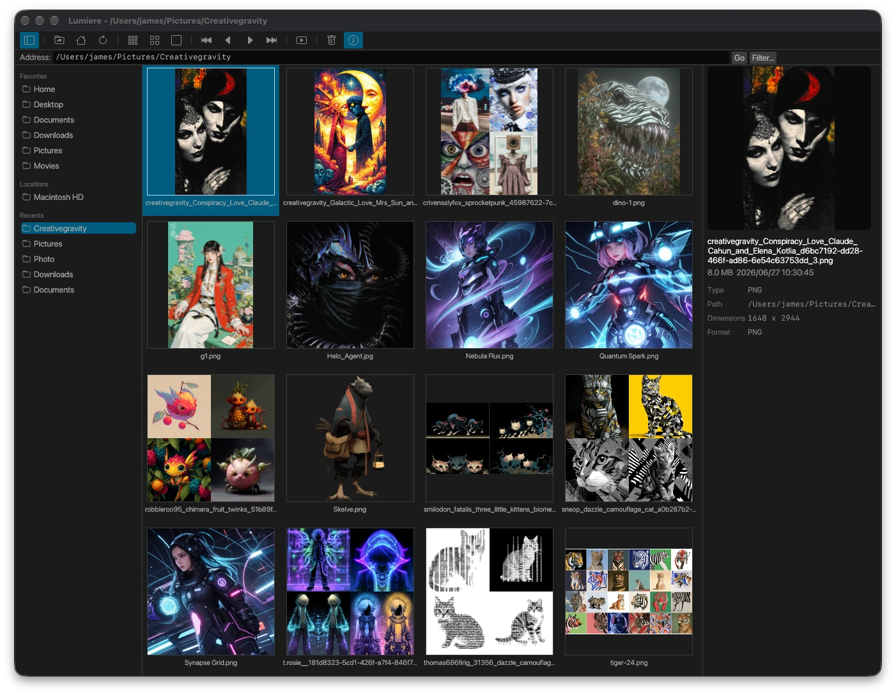

# Lumiere

English | [繁體中文](README.zh-TW.md)

[](https://github.com/fetag/lumiere/actions/workflows/ci.yml)
[](LICENSE)
[](https://github.com/fetag/lumiere/releases/latest)

Lumiere is a cross-platform image viewer for macOS, Linux, and Windows.

I started this project because I wanted a fast image viewer that I enjoy using. Open a folder, browse thumbnails, quickly look through photos and images, and organize them. That's all there is to it, and I want to keep it that way.

Lumiere isn't meant to grow bloated with flashy features or things most people rarely use. Browsing images will always be its main purpose. It also plays animated GIFs, with experimental support for MP4 and AVI videos and 3D model (.glb) viewing.



## What it can do

- Start quickly thanks to its small and simple design
- Browse folders and image thumbnails, with previews and basic information
- Zoom and rotate images, or view them in full screen or as a slideshow
- Play animated GIFs and MP4 or AVI videos, including audio and seeking
- View 3D models (.glb) with orbit, zoom, and wireframe and auto-rotate toggles
- Organize images by renaming, copying, or moving them; deleted items go to the system Trash after confirmation
- Follow your system's light or dark appearance and remember the last opened folder and window position

## Download and install

Visit the [Releases](https://github.com/fetag/lumiere/releases/latest) page and download the version for your computer.

### macOS

Download the macOS zip, extract it, and move `Lumiere.app` to your Applications folder. Currently, only Apple Silicon Macs are supported; an Intel Mac version is not yet available.

The first time you open it, macOS may say the developer cannot be verified. In Finder, right-click `Lumiere.app`, select **Open**, and confirm. Alternatively, go to **System Settings** → **Privacy & Security** and select **Open Anyway**.

### Windows

Download the Windows zip, extract it, and run `lumiere.exe`. No installation is needed.

### Linux

An x86_64 version is available, built on Linux Mint 22.3; the executable requires glibc 2.39 or newer. Other distributions have not been tested, and compatible graphics libraries and drivers are required.

- **`.deb`**: For Debian, Ubuntu, Linux Mint, and similar systems. Install with `sudo apt install ./filename.deb`.
- **AppImage**: Make it executable and run it. FUSE is required; if you don't have FUSE, run it with `--appimage-extract-and-run`.
- **Portable package**: Extract it and run the included `./install.sh`. No `sudo` is needed.

## Supported formats

Common image formats include JPEG, PNG, GIF, BMP, TIFF, WebP, TGA, PCX, ICO, and SVG. On macOS, HEIC, HEIF, and AVIF are also supported.

Animated SVGs show only the first frame. Animated GIFs can be played and paused in the viewer, while thumbnails and previews remain static. If a file exceeds the playback resource limits, it will also be shown as a static image.

MP4 and AVI playback is experimental. Videos currently show a placeholder in the thumbnail and preview areas. Release downloads include video playback support; if building from source, enable the `video` feature and provide libmpv and its runtime dependencies.

GLB 3D model viewing is experimental. A `.glb` file can be opened in the viewer and supports orbiting with the mouse or the WASD keys, zooming with the scroll wheel, and resetting the view with a double-click, with wireframe and auto-rotate toggles. Model thumbnails are rendered on the GPU. Release downloads include model viewing support; if building from source, enable the `models` feature.

*If you don't need MP4 or AVI playback, you can remove the mpv library to save disk space.*

## Common controls

| Key | Action |
| --- | --- |
| Arrow keys | Move the selection |
| Home / End | Select the first / last image |
| PageUp / PageDown | Previous / next image |
| Space or Enter | Open an image |
| Esc | Close a dialog, stop the slideshow, or exit the viewer |
| F2 | Rename |
| `+` / `-` | Zoom in / out in the viewer |
| `1` / `F` | Show at actual size / fit to window in the viewer |

More shortcuts are listed in the app's menus.

## Build it yourself

You'll need Rust and Cargo. After downloading the source, run these commands from the project directory:

```sh
cargo build --release
./target/release/lumiere /path/to/folder
```

See [CONTRIBUTING.md](CONTRIBUTING.md) for platform-specific build and test instructions and ways to contribute.

## Feedback and contributions

Bug reports and suggestions are welcome through [GitHub Issues](https://github.com/fetag/lumiere/issues).

Feature suggestions will be considered with a focus on making image viewing easier while keeping Lumiere simple.

For security issues, see [SECURITY.md](SECURITY.md). Notable changes are recorded in [CHANGELOG.md](CHANGELOG.md).

This project follows a [Code of Conduct](CODE_OF_CONDUCT.md).

## License

Lumiere is licensed under the [GNU General Public License, version 3 or later](LICENSE) (GPL-3.0-or-later).

For third-party licensing notices, see [THIRD_PARTY_NOTICES.md](THIRD_PARTY_NOTICES.md).
