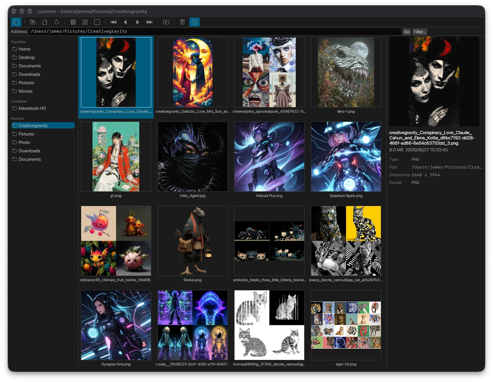

# Lumiere

[English](README.md) | 繁體中文

[](https://github.com/fetag/lumiere/actions/workflows/ci.yml)
[](LICENSE)
[](https://github.com/fetag/lumiere/releases/latest)

Lumiere 是一個給 macOS、Linux 和 Windows 跨平台支持的看圖工具。

做這個專案，單純是想要一個自己喜歡用、可以快速瀏覽圖片的工具。打開資料夾，瀏覽縮圖快速翻閱各種照片與圖片，進行整理，就這麼簡單，而且一直保持簡單。

它不打算為了增加各種花俏的功能而變得肥大，也不想塞進一些多數時間用不到的功能。瀏覽圖片始終是 Lumiere 最重要的事；除了圖片，目前也支援播放 GIF 動畫，以及實驗性的支持 MP4、AVI 影片。



## 可以做什麼

- 因為小而簡單，所以可以極快速的啟動
- 瀏覽資料夾和圖片縮圖，預覽照片與基本資訊
- 開啟圖片後放大、縮小、旋轉，或用全螢幕和投影片模式觀看
- 播放 GIF 動畫；也可以播放 MP4、AVI 影片，包含聲音與進度拖曳
- 整理操作：重新命名、複製、移動圖片，刪除時會在確認後移到系統垃圾桶
- 跟隨系統的淺色或深色外觀，記住上次開啟的資料夾視窗位置

## 下載與安裝

到 [Releases](https://github.com/fetag/lumiere/releases/latest) 頁面下載適合自己電腦的版本。

### macOS

下載 macOS zip，解壓縮後將 `Lumiere.app` 放到「應用程式」資料夾。目前提供 Apple Silicon 版本，尚未提供 Intel Mac 版本。

第一次開啟時，macOS 可能提示無法驗證開發者。可以在 Finder 中對 `Lumiere.app` 按右鍵，選擇「開啟」並確認；或到「系統設定」→「隱私權與安全性」，選擇「仍要開啟」。

### Windows

下載 Windows zip，解壓縮後執行 `lumiere.exe`，不需要安裝。

### Linux

目前提供 x86_64 版本，在 Ubuntu 22.04 上建置；其他發行版尚未經過測試，且需要相容的圖形函式庫和驅動程式。

- **`.deb`**：適合 Debian、Ubuntu、Linux Mint 等系統，可使用 `sudo apt install ./檔案名稱.deb` 安裝。
- **AppImage**：加上執行權限後即可開啟；需要 FUSE，若沒有 FUSE，可加上 `--appimage-extract-and-run` 執行。
- **portable 套件**：解壓縮後執行其中的 `./install.sh`，不需要 `sudo`。

## 支援的格式

常見圖片格式包括 JPEG、PNG、GIF、BMP、TIFF、WebP、TGA、PCX、ICO 和 SVG；macOS 另外支援 HEIC、HEIF 和 AVIF。

SVG 動畫只顯示第一格，GIF 動畫可以在檢視器中播放與暫停，縮圖和預覽則顯示靜態畫面；檔案超出播放資源限制時，也會改為顯示靜態畫面。

MP4 和 AVI 播放目前仍是實驗性功能，影片在縮圖和預覽區會顯示佔位圖示。下載的 release 已包含影片播放支援；若自行從原始碼建置，需啟用 `video` feature，並準備 libmpv 及其執行時相依套件。

*若不需要 MP4, AVI 播放功能，刪除 mpv 程式庫可以減少空間佔用*

## 常用操作

| 按鍵 | 操作 |
| --- | --- |
| 方向鍵 | 移動選取 |
| Home / End | 選取第一張／最後一張圖片 |
| PageUp / PageDown | 上一張／下一張圖片 |
| Space 或 Enter | 開啟圖片 |
| Esc | 關閉對話框、停止投影片或離開檢視器 |
| F2 | 重新命名 |
| `+` / `-` | 在檢視器中放大／縮小 |
| `1` / `F` | 在檢視器中以實際大小／配合視窗顯示 |

其他快捷鍵可以在程式的選單中查看。

## 自行建置

需要 Rust 和 Cargo。下載原始碼後，在專案目錄執行：

```sh
cargo build --release
./target/release/lumiere /path/to/folder
```

各平台的建置、測試與貢獻方式請見 [CONTRIBUTING.md](CONTRIBUTING.md)。

## 意見與貢獻

歡迎透過 [GitHub Issues](https://github.com/fetag/lumiere/issues) 回報問題或提出建議。

你的功能建議是否被接受會以「讓看圖更順手、保持簡單」為方向考量。

安全問題請參考 [SECURITY.md](SECURITY.md)，重要變更記錄在 [CHANGELOG.md](CHANGELOG.md)。

本專案遵守[行為準則](CODE_OF_CONDUCT.md)。

## 授權

Lumiere 採用 [GNU General Public License, version 3 or later](LICENSE)（GPL-3.0-or-later）授權。

第三方素材的授權聲明請見 [THIRD_PARTY_NOTICES.md](THIRD_PARTY_NOTICES.md)。
